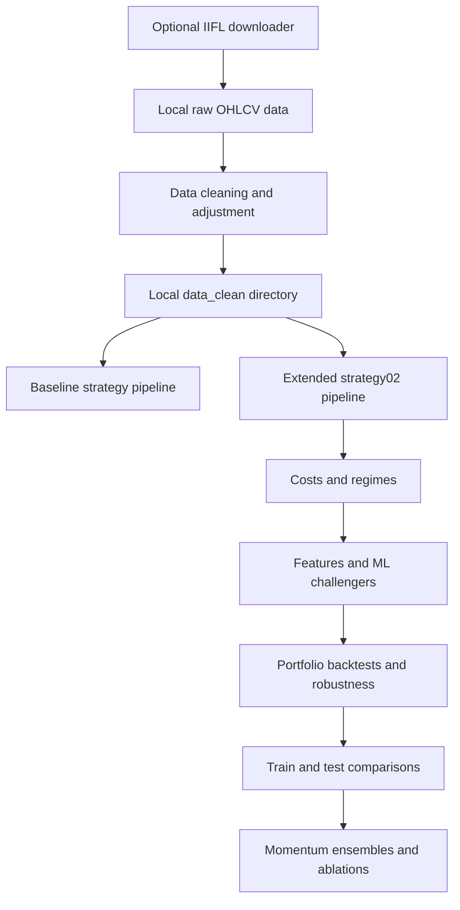

# Indian Equity Momentum Research

A Python research workspace for Indian equity momentum, market regimes, transaction-cost modelling and portfolio evaluation. It includes market-data acquisition and cleaning, a baseline research pipeline, and an extended pipeline for momentum ensembles and train/test experiments.

## Architecture



The diagram summarizes research components. Results depend on the data, assumptions and execution order; this is not an automated trading service.

## Repository guide

| Location | Purpose |
|---|---|
| `iifl_fetch_nifty100.py` | Optional multi-timeframe market-data download using your IIFL credentials |
| `clean_nifty100.py` | Raw-bar cleaning, session tagging and inferred adjustment factors |
| `strategy/` | Baseline phases 1–8, including daily and intraday research |
| `strategy02/` | Extended phases 1–11, including equity momentum ensembles and portfolio experiments |
| [docs/data.md](docs/data.md) | Input layout, schema and credential handling |
| [docs/run-guide.md](docs/run-guide.md) | Setup, execution order and generated outputs |

Keep both pipeline directories intact. Scripts import sibling phase modules, and the extended pipeline can optionally read an output from the baseline pipeline.

## Setup

Use Python 3.10 or newer: the source uses Python 3.10 type syntax. Dependencies are listed from source inspection; a clean-environment installation and version lock have not been validated.

```powershell
python -m venv .venv
.venv\Scripts\python -m pip install -r requirements.txt
```

On macOS/Linux, use `.venv/bin/python` instead. The full manifest includes PyTorch, LightGBM and Optuna for the modelling phases; installation requirements vary by platform.

## Getting started

1. Obtain authorized local OHLCV data following [the data guide](docs/data.md). No datasets are bundled.
2. Run `clean_nifty100.py` to create `data_clean/`, or provide equivalent cleaned inputs.
3. Follow [the ordered execution guide](docs/run-guide.md), starting with phase 1 in `strategy02/`.
4. Inspect validation outputs before interpreting portfolio results.

The optional downloader loads local credentials and may open a browser for authentication. Neither login nor market-data downloads were run for this publication.

## Research scope

The extended pipeline covers cost assumptions, stochastic regimes, features, LightGBM and neural-network challengers, portfolio construction, robustness analysis, train/test splits, daily exposure overlays, residual/consensus momentum, and portfolio-rule ablations. These are experiments, not claims that every method improves performance.

## Limitations

- No performance headline is asserted here; historical results were not rerun for publication.
- Membership selection and corporate-action inference can bias results. Use point-in-time universes and independently validated adjustments where possible.
- Parameters, costs, tax assumptions and margin proxies embedded in the code are research assumptions, not verified current broker terms.
- Repeated experimentation can contaminate a held-out period. Preserve truly untouched evaluation data.
- Source syntax and publication-file checks were completed; dependency installation, API integration and full backtests remain unverified.
- Documentation comments inside the source describe the original experiments and should be assessed against the actual implementation.

## Security and publication scope

This repository contains selected source, setup documentation and an empty `.env.example`. Populated environment files, broker sessions, private data, generated results, PDFs and local Git history are excluded. Never commit `.env` or `iifl_session.json`; the downloader caches a session locally. Avoid sharing authentication URLs, terminal logs or API responses.

## License

No open-source license has been selected. Public visibility alone does not grant general reuse or redistribution rights.
